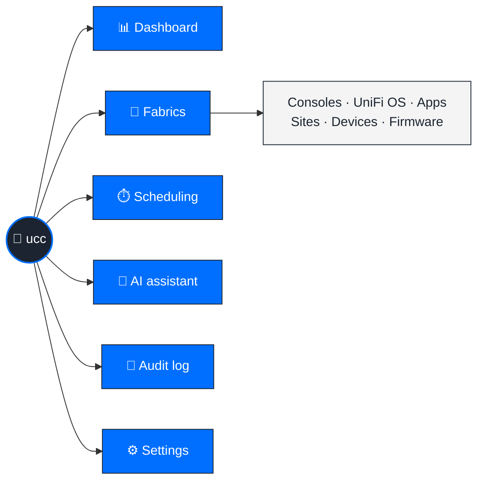

  

<h1 align="center">📡 ucc — UniFi Control Center</h1>

<em>UniFi updates across every console and site — only when the community says the release is safe.</em>

---

Every page needs a login (local, LDAP, or OIDC — plus TOTP/passkey 2FA),
gated by RBAC roles you define, and optionally restricted to specific
Fabrics per account. Design decisions live in
[🏗️ Architecture](Architecture.md); this page is the map.

> [!NOTE]
> Three processes, one Redis: **web** (FastAPI), **worker** (Celery — every
> UniFi Site Manager call and AI job), **beat** (the one and only scheduler —
> never scale it past 1 replica). See [Background tasks](Architecture.md#background-tasks-celery-and-celery-beat).

## 📑 Read next

| Page | For when you need to... |
|---|---|
| [🚀 Installation](Installation.md) | Stand the thing up — Docker, reverse proxy, env vars, backups |
| [📡 UniFi Integration](UniFi-Integration.md) | Fabrics, the inventory sync, the connector proxy, and the AI-gated update roadmap |
| [🏗️ Architecture](Architecture.md) | Understand *why* it's built this way (stack, layout, security essentials) |
| [🔐 Authentication & RBAC](Authentication-RBAC.md) | Logins, sessions, roles/permissions, Fabric scope, 2FA |
| [📝 Audit Log](Audit-Log.md) | Hash-chain integrity, retention, export, SIEM forwarding |
| [🔔 Notifications](Notifications.md) | Rules, role-based targeting, templates, every placeholder |
| [📏 Host Requirements](Host-Requirements.md) | Size the server ucc runs on |
| [🧠 AI Assistant](AI-Assistant.md) | Wire up the chat assistant and understand its guardrails |
| [🛠️ Development](Development.md) | Run it locally, add a feature, ship a migration |

## 🔒 Sitting behind a reverse proxy

ucc only ever speaks plain HTTP (port `8080`) — it expects a TLS
terminator in front of it, always:

- **[Caddy](Reverse-Proxy-Caddy.md)** — bundled, zero-config HTTPS.
- **[nginx](Reverse-Proxy-Nginx.md)** — you already run one for everything else.
- **[Traefik](Reverse-Proxy-Traefik.md)** — you're already all-in on Docker labels.

## ✨ What's in the box

| Tab | The highlights |
|---|---|
| 📊 **Dashboard** | Fabric/console/device counts, how many have updates pending or are offline, upcoming schedules, recent audit activity |
| 🧵 **Fabrics** | Add a UniFi Site Manager API key (validated, stored encrypted, never shown again); browse every console's UniFi OS and application versions and every device's firmware, with the available update; live refresh after each sync |
| ⏱️ **Scheduling** | Cron an action against a site, a Fabric, or all Fabrics — today: an immediate inventory sync; next: AI-gated firmware/app updates |
| 🧠 **AI assistant** | Chat about your inventory (5 provider choices) — read-only lookups, scoped to the Fabrics you may see |
| 📝 **Audit log** | Hash-chained, tamper-evident, exportable, optionally forwarded to your SIEM |
| 👤 **Users & Roles** | Full RBAC matrix, per-account Fabric scope, temporary permission grants, bulk actions, SSO, role export/import |
| 🔔 **Notifications** | Rules — which events (sync failed, release assessed, update blocked/succeeded/failed), who (users/roles), which Fabrics — by email or webhook, with editable templates and a delivery log |
| ⚙️ **Settings** | Inventory sync interval, retention policies, LDAP/OIDC/syslog/SMTP integrations, AI provider config |
